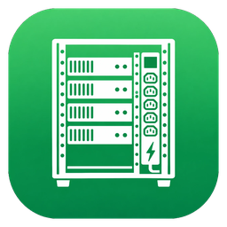

# APC Rack Power

Home Assistant custom integration for APC UPS and Rack PDU devices via SNMP (v1/v2c/v3).

> **Disclaimer:** This is an unofficial, community-maintained integration and is not affiliated with, endorsed by, or supported by APC or Schneider Electric. All product names, logos, and brands are property of their respective owners and are used for identification purposes only.

## Highlights
- **One integration for UPS and Rack PDU** with a Network Management Card (NMC). The device type is detected automatically and only entities the device supports are created.
- **UPS:** battery, runtime, input/output, power and energy (Energy dashboard), alarms, self test and runtime calibration, outlet groups on/off/reboot.
- **Rack PDU:** power, energy, load, phases and banks with thresholds, per-outlet metering, outlets on/off/reboot, chained PDUs as own devices.
- **Temperature/humidity probes** on the card, the PDU sensor port and older environmental monitors.
- **SNMP traps (optional):** the card reports events immediately, as an event entity, as device triggers and as an `apc_rack_power_trap` event.
- **SNMPv1, v2c and v3**, DHCP discovery, reconfigure, re-authentication and repair issues.
- **Settings on the device:** outlet names, power-on/off delays, reboot duration and thresholds as entities (disabled by default); custom OIDs for anything not covered.

## Installation

Requires Home Assistant 2025.7 or newer.

The button opens the Marketplace on Home Assistant 2026.11 or newer, and HACS on older versions.

### Marketplace (Home Assistant 2026.11 or newer)
1. Open `Settings -> Marketplace` and search for `APC Rack Power`.
2. Install it.

### HACS (older Home Assistant versions)
1. Open HACS and search for `APC Rack Power`.
2. Download it and restart Home Assistant.

### Manual
1. Copy `custom_components/apc_rack_power` into the `custom_components` folder of your Home Assistant configuration.
2. Restart Home Assistant.

## Setup

1. Enable SNMP on the network card (`Configuration -> Network -> SNMPv3` or `SNMPv1`) and allow the Home Assistant host in the card's access control list.
2. Add the integration under `Settings -> Devices & Services -> Add Integration`, enter the address and choose the SNMP version.
3. Enter the credentials:
   - **SNMPv3 (recommended):** user name, authentication and privacy protocol with their passphrases. They must match the user configured on the card.
   - **SNMPv1/v2c:** read community and, for switching and tests, a write community.

APC cards that request an address via DHCP are discovered automatically and show up under `Settings -> Devices & Services`.

### Why SNMPv3?
SNMPv1 and SNMPv2c send the community string and all values in plain text. Anyone on the network who sees one request knows the community, and the write community allows switching outlets off. SNMPv3 with `authPriv` authenticates every request and encrypts the traffic. Most APC cards (including the AP9641 tested here) offer only SHA (SHA-1) or MD5 and AES (AES-128) or DES: choose SHA and AES. Use the SHA-2 and AES-192/256 options only if your card lists them.

For AES-192/256 two key formats exist. The default entries use the Blumenthal format (net-snmp). If the card rejects them, try the "Cisco/Reeder" variants.

You can move an existing entry to SNMPv3 at any time via `Reconfigure`.

### SNMP traps (optional)
1. In the integration options enable `Receive SNMP traps` and keep port 162, or choose a port above 1024 if Home Assistant cannot open port 162.
2. On the card, add Home Assistant as trap receiver (`Configuration -> Notification -> SNMP Traps -> Trap Receivers`) with the same port.
3. Each trap triggers an immediate update and an `apc_rack_power_trap` event with `entry_id`, `host`, `trap_oid`, `message` (the card's text, e.g. "Rack PDU 1: Outlet #24 on.") and all values, which you can use in automations.
4. With SNMPv3 entries the card can send SNMPv3 traps: they are verified and decrypted with the entry's user. SNMPv1/v2c traps need the trap community.
5. A firewall on the Home Assistant host must allow UDP from the card to the trap port.

## Supported Devices
The integration reads the standard UPS-MIB (RFC 1628) and the APC PowerNet-MIB and creates entities for what the device answers:

| Device family | Tables used |
|---|---|
| Smart-UPS / Symmetra with NMC2 or NMC3 (AP9630/31/40/41 ...) | UPS-MIB (incl. per-line values of 3-phase units), `upsBasic`/`upsAdv`/`upsHighPrec`, outlet groups, universal I/O probes |
| Switched/metered Rack PDU, current firmware (AP79xx, AP86xx, AP88xx, AP89xx) | `rPDU2` device, phases, banks, switched and metered outlets, sensor port |
| Easy PDU (EPDU1xxx) | `ePDU` device, phases, switched outlets |
| Rack PDU with older firmware | `rPDU` load and outlets, MasterSwitch `sPDU` outlets |
| Older environmental monitors | integrated environmental monitor (`iem`), modular sensors (`mem`) |

### Tested Hardware
- APC Smart-UPS SRT3000UXI-NCLI with AP9641 (two temperature probes)
- APC External Battery Pack XBP48RM1U2-LI (connected to SRT3000UXI-NCLI)
- APC Switched Rack PDU AP8959EU3

Other models are covered by the same MIB tables but not tested yet. Diagnostics downloads (credentials and serial numbers are redacted) help to add support for them.

## Provided Services
- `apc_rack_power.set_oid`: write a value (integer, text or time ticks) to any writable OID
- `apc_rack_power.control_action`: switch an outlet or outlet group on/off or reboot it

## Upgrading
See the [release notes](https://github.com/42bios/apc-rack-power/releases) for what changed. Coming from 0.3.x, read the upgrade notes of [0.4.0](https://github.com/42bios/apc-rack-power/releases/tag/v0.4.0) first.

## Support

- Issues: https://github.com/42bios/apc-rack-power/issues

## License
MIT - see [LICENSE](LICENSE).
